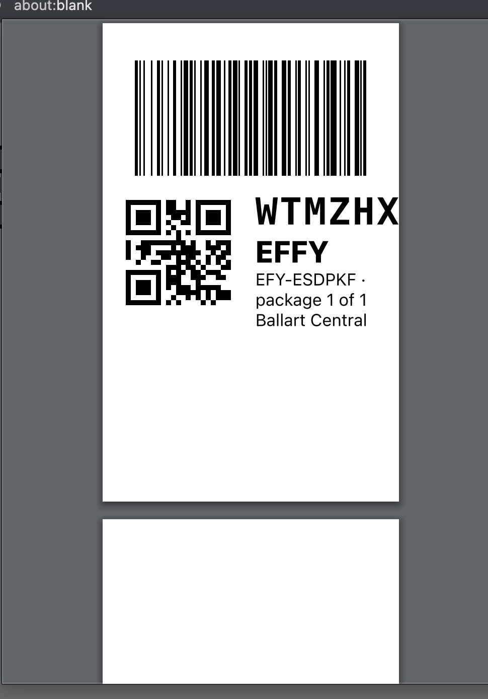
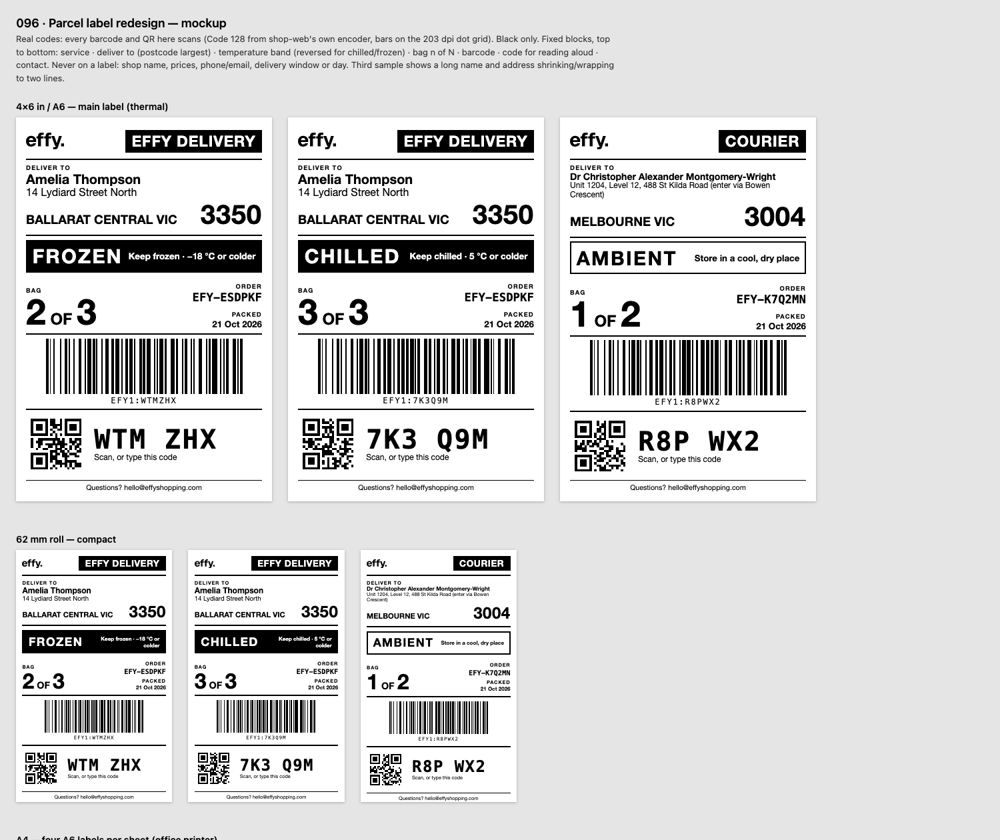

# 096 — Label redesign (US10)

## Before (089, as printed on 2026-10-21)

What is wrong with it:

- **The code runs off the label.** "WTMZHX" is clipped at the right edge: a 22 pt code beside a 26 mm QR
  does not fit the 56 mm printable width of the 62 mm roll.
- **Two-thirds of the label is empty**, and **a blank second page prints**: the label is sized for the
  page, not the content, and the page break follows every label.
- **There is no hierarchy.** The code, "EFFY", the order number, "package 1 of 1" and the suburb sit in
  one column at near-equal weight. Nothing tells the eye where to go first.
- **Information is missing.** There is no recipient, no postcode, and no temperature for an ambient
  portion. "Package 1 of 1" counts *shops*, not bags. There is no packed date and no Effy mark or
  contact.
- **The barcode bars are off the printer's dot grid** (0.31 mm at 203 dpi = 2.4 dots), so each bar is
  rounded separately.

## After (proposed)

Live mockup with scannable codes: [label-mockup.html](label-mockup.html). Open it in a browser and
scan the screen with a phone. The mockup's generator is a one-off and not part of the build.

### Blocks, top to bottom (every size)

| # | Block | Content | Rule |
|---|---|---|---|
| 1 | Header | Effy wordmark · **EFFY DELIVERY** or **COURIER**, reversed | Who takes it away, the shop's only delivery fact (079) |
| 2 | Deliver to | Recipient name · street · SUBURB STATE · **postcode (largest)** | Long text steps down to a floor, then wraps to two lines, and is never clipped |
| 3 | Temperature | **FROZEN** / **CHILLED** reversed full width with a storage line; **AMBIENT** outlined | Never shrinks |
| 4 | Bag | **BAG n OF N** (largest on the label) · order number · packed date | N counts this package's live bags only |
| 5 | Barcode | Code 128 of `EFY1:<code>`, full width, human-readable value beneath | Bars on whole printer dots, never scaled |
| 6 | Code | QR of the same token · code grouped `WTM ZHX` · "Scan, or type this code" | For a phone at an angle, or for reading aloud |
| 7 | Footer | Questions? hello@effyshopping.com | The approved customer-facing address |

**Never on a label:** the shop's name, any price, the customer's phone or email, any delivery window,
day or estimate.

### Sizes

| Size | Use | Notes |
|---|---|---|
| 4×6 in / A6 (100×150 mm) | **Main.** Direct-thermal printers | Bar module 0.50 mm (4 dots at 203 dpi) |
| A4, four A6 per sheet | Office printers on 4-up A6 sticker sheets | Same layout as A6, one per quarter |
| 62 mm roll (62×100 mm) | Compact roll printers | Same blocks, scaled down; bar module 0.25 mm (2 dots); text floor 5.5 pt |
| ~~A4 21-up (63.5×38.1 mm)~~ | **Retired** | Cannot hold an address at a readable size |

Black only, with no greys or tints, so labels print cleanly on direct-thermal paper.
